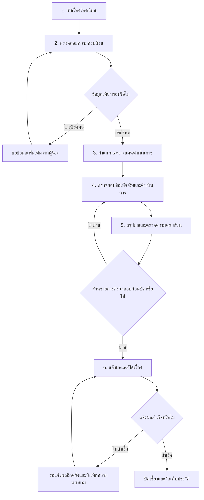

# Flow หลังบ้านของระบบร้องเรียน

เอกสารฉบับนี้กำหนดการทำงานแบบ Timeline ทีละขั้นสำหรับเจ้าหน้าที่ผู้รับผิดชอบหนึ่งคน ตั้งแต่รับเรื่องจนถึงแจ้งผลและปิดเรื่อง โดยไม่มีขั้นตอนอนุมัติจากหัวหน้างาน เจ้าหน้าที่จะไปขั้นถัดไปได้ต่อเมื่อกรอกข้อมูลและผ่านเงื่อนไขของขั้นปัจจุบันครบถ้วนแล้ว

## 1. หลักการของกระบวนการ

- เจ้าหน้าที่คนเดียวสามารถดำเนินการได้ตั้งแต่รับเรื่อง คัดกรอง ตรวจสอบ ดำเนินการ สรุปผล แจ้งผล และปิดเรื่อง
- หน้าจอแสดงเป็น Timeline จำนวน 6 ขั้น พร้อมข้อความ `ขั้นตอนที่ X จาก 6`
- ขั้นที่ยังไม่ถึงต้องถูกล็อกและแสดงเหตุผลว่าต้องทำอะไรให้เสร็จก่อน
- ทุกขั้นมีคำอธิบาย ข้อมูลที่ต้องกรอก เงื่อนไขผ่าน และปุ่มดำเนินการที่ชัดเจน
- ระบบต้องตรวจสอบเงื่อนไขที่ฝั่งเซิร์ฟเวอร์เสมอ ไม่ใช้เพียงการซ่อนหรือปิดปุ่มบนหน้าจอ
- ชื่อสถานะและข้อความทั้งหมดที่ผู้ใช้เห็นต้องเป็นภาษาไทย รหัสภาษาอังกฤษใช้ภายในระบบเท่านั้น
- ทุกการผ่านขั้นตอน ย้อนกลับ แก้ไขข้อมูลสำคัญ แจ้งผล และปิดเรื่อง ต้องบันทึกผู้ดำเนินการ วันเวลา และรายละเอียดลงประวัติ

## 2. แผนผังกระบวนการ

## 3. ขั้นตอน Timeline และเงื่อนไขผ่าน

| ขั้น | ชื่อที่แสดง | สิ่งที่เจ้าหน้าที่ต้องทำ | เงื่อนไขผ่านขั้นตอน | สถานะหลังผ่าน |
| --- | --- | --- | --- | --- |
| 1 | รับเรื่องร้องเรียน | ตรวจข้อมูลผู้ร้อง ช่องทางติดต่อ รายละเอียดเรื่อง และเลขติดตามที่ระบบออกให้ | มีเลขติดตาม วันที่รับ ช่องทาง รายละเอียดเรื่อง และข้อมูลติดต่อที่จำเป็น | รอตรวจสอบข้อมูล |
| 2 | ตรวจสอบความครบถ้วน | ตรวจรายละเอียดและเอกสาร หากข้อมูลไม่พอให้ระบุรายการที่ขอเพิ่มและบันทึกการติดต่อ | เลือกผลตรวจว่า “ข้อมูลครบถ้วน” หรือเข้าสถานะ “รอข้อมูลเพิ่มเติม” พร้อมเหตุผล | พร้อมจำแนกเรื่อง หรือรอข้อมูลเพิ่มเติม |
| 3 | จำแนกและวางแผนดำเนินการ | เลือกประเภท/ประเภทย่อย ระดับความเร่งด่วน หน่วยงานที่เกี่ยวข้อง ผู้รับผิดชอบ และวันครบกำหนด | ข้อมูลจำแนก ผู้รับผิดชอบ และวันครบกำหนดครบถ้วน | กำลังดำเนินการ |
| 4 | ตรวจสอบข้อเท็จจริงและดำเนินการ | บันทึกสิ่งที่ตรวจสอบ การดำเนินการ ผลที่พบ ความคืบหน้า และหลักฐาน | มีบันทึกการดำเนินการอย่างน้อยหนึ่งรายการ มีผลการตรวจสอบ และมีหลักฐานหรือเหตุผลว่าไม่มีหลักฐาน | พร้อมสรุปผล |
| 5 | สรุปผลและตรวจความครบถ้วน | จัดทำสรุปผล เลือกประโยคขึ้นต้น ตรวจข้อความที่ผู้ร้องจะเห็น และยืนยันรายการตรวจสอบก่อนปิด | สรุปผลครบ ผ่าน checklist ไม่มีข้อมูลภายใน/ข้อมูลอ่อนไหวที่ไม่ควรเปิดเผย และยืนยันความถูกต้อง | รอแจ้งผล |
| 6 | แจ้งผลและปิดเรื่อง | เลือกช่องทางแจ้งผล ตรวจตัวอย่างข้อความ ส่งข้อความ และบันทึกผลการแจ้ง | แจ้งผลสำเร็จ หรือบันทึกหลักฐานการแจ้งด้วยวิธีอื่นครบถ้วน | ปิดเรื่องแล้ว |

### กรณีรอข้อมูลเพิ่มเติม

- ขั้นที่ 2 ยังถือว่าเป็นขั้นปัจจุบันและยังไม่ปลดล็อกขั้นที่ 3
- ต้องระบุข้อมูลที่ขอเพิ่ม ช่องทางติดต่อ และวันเวลาที่ติดต่อ
- เมื่อได้รับข้อมูล เจ้าหน้าที่กด `ได้รับข้อมูลเพิ่มเติมแล้ว` แล้วตรวจความครบถ้วนอีกครั้ง
- ระหว่างรอ ระบบแสดงสถานะ `รอข้อมูลเพิ่มเติม` และแสดงจำนวนวันที่รอ

### กรณีแจ้งผลไม่สำเร็จ

- ห้ามแสดงว่าเรื่องปิดแล้วหากยังไม่มีหลักฐานการแจ้งผลตามนโยบายของหน่วยงาน
- ระบบแสดงสถานะ `รอแจ้งผลอีกครั้ง`
- ต้องบันทึกช่องทาง วันเวลา และสาเหตุที่แจ้งไม่สำเร็จทุกครั้ง
- เมื่อแจ้งสำเร็จจึงเปลี่ยนเป็น `ปิดเรื่องแล้ว`

## 4. สถานะภาษาไทยที่แสดงบนหน้าจอ

รหัสภายในไม่ต้องแสดงต่อเจ้าหน้าที่หรือผู้ร้องเรียน ให้ใช้ชื่อภาษาไทยดังนี้

| รหัสภายใน | ชื่อที่แสดงภาษาไทย | ความหมาย |
| --- | --- | --- |
| `RECEIVED` | รับเรื่องแล้ว | ระบบรับเรื่องและออกเลขติดตามแล้ว |
| `SCREENING` | รอตรวจสอบข้อมูล | เจ้าหน้าที่กำลังตรวจความครบถ้วน |
| `WAITING_INFO` | รอข้อมูลเพิ่มเติม | ขอข้อมูลจากผู้ร้องและยังไปขั้นถัดไปไม่ได้ |
| `CLASSIFYING` | กำลังจำแนกเรื่อง | กำลังกำหนดประเภท ความเร่งด่วน และกรอบเวลา |
| `IN_PROGRESS` | กำลังดำเนินการ | กำลังตรวจสอบข้อเท็จจริงหรือแก้ไขปัญหา |
| `READY_TO_SUMMARIZE` | พร้อมสรุปผล | ข้อมูลการดำเนินการครบและพร้อมจัดทำสรุป |
| `PENDING_NOTIFICATION` | รอแจ้งผล | สรุปผลครบแล้วและรอแจ้งผู้ร้อง |
| `NOTIFICATION_RETRY` | รอแจ้งผลอีกครั้ง | เคยแจ้งแล้วไม่สำเร็จและต้องดำเนินการใหม่ |
| `CLOSED` | ปิดเรื่องแล้ว | แจ้งผลสำเร็จและปิดเรื่องเรียบร้อย |
| `REJECTED` | ยุติเรื่อง | ไม่รับดำเนินการหรือยุติเรื่องพร้อมเหตุผล |

เพื่อไม่ให้กระทบ API และรายงานเดิม สามารถเก็บ `Complaint.Status` เดิมเป็นสถานะภาพรวม และเพิ่ม `WorkflowStep` สำหรับควบคุม Timeline โดยแปลงเป็นข้อความภาษาไทยก่อนแสดงผลทุกจุด

## 5. รูปแบบหน้าจอ Timeline

Timeline ใช้รูปแบบแนวตั้งทั้งเดสก์ท็อปและมือถือ แต่ละขั้นเป็นการ์ดที่มีหมายเลข ชื่อขั้น คำอธิบาย และสถานะ

### ขั้นที่เสร็จแล้ว

- แสดงไอคอนเครื่องหมายถูกและข้อความ `เสร็จแล้ว`
- แสดงผู้ดำเนินการและวันเวลาที่ผ่านขั้น
- เปิดดูข้อมูลย้อนหลังได้
- แก้ไขได้ก่อนปิดเรื่อง แต่หากแก้ข้อมูลสำคัญ ระบบต้องยกเลิกการยืนยันของขั้นถัดไปที่ได้รับผลกระทบ

### ขั้นปัจจุบัน

- ขยายการ์ดอัตโนมัติและแสดงฟอร์มที่ต้องดำเนินการ
- แสดงข้อความ `กำลังดำเนินการ` และ `ขั้นตอนที่ X จาก 6`
- ช่องข้อมูลต้องมี label ที่มองเห็นได้ พร้อมคำอธิบายและข้อผิดพลาดใกล้ช่องนั้น
- ปุ่มหลักใช้ข้อความตามงาน เช่น `ยืนยันข้อมูลครบถ้วนและไปขั้นถัดไป` แทนคำว่า `บันทึก`

### ขั้นที่ยังล็อก

- แสดงไอคอนล็อก ชื่อขั้น และข้อความ เช่น `ต้องผ่านขั้นตรวจสอบความครบถ้วนก่อน`
- ห้ามเปิดฟอร์มหรือส่งคำขอข้ามขั้น แม้เรียก URL หรือ endpoint โดยตรง
- ไม่ใช้สีเพียงอย่างเดียวในการบอกสถานะ ต้องมีไอคอนและข้อความกำกับเสมอ

### การแสดงผลและการเข้าถึง

- ปุ่มและพื้นที่กดมีขนาดอย่างน้อย 44 × 44 พิกเซล
- ใช้งานด้วยคีย์บอร์ดได้และมี focus ที่มองเห็นชัดเจน
- เมื่อ validation ไม่ผ่าน ให้เลื่อนไปยังข้อผิดพลาดแรกและแสดงสรุปข้อผิดพลาดด้านบนของขั้นปัจจุบัน
- หลังผ่านขั้น ให้แสดงข้อความสำเร็จและย้าย focus ไปยังหัวข้อของขั้นใหม่
- บนมือถือห้ามเกิด horizontal scroll และให้แสดงการ์ดทีละขั้นในแนวตั้ง

## 6. Checklist ก่อนปิดเรื่อง

ในขั้นที่ 5 ระบบต้องตรวจอย่างน้อยดังนี้

- [ ] บันทึกข้อเท็จจริงและสิ่งที่ตรวจสอบครบถ้วน
- [ ] บันทึกการดำเนินการและผลลัพธ์ครบถ้วน
- [ ] มีหลักฐานแนบ หรือมีเหตุผลว่าไม่มีหลักฐาน
- [ ] ข้อความสรุปใช้ภาษาที่ผู้ร้องเข้าใจได้
- [ ] ข้อความที่จะส่งไม่มีบันทึกภายในหรือข้อมูลอ่อนไหวที่ไม่ควรเปิดเผย
- [ ] เจ้าหน้าที่ตรวจตัวอย่างข้อความที่จะส่งแล้ว
- [ ] เจ้าหน้าที่ยืนยันว่าข้อมูลถูกต้องและพร้อมแจ้งผล

Checkbox เป็นการยืนยันความครบถ้วน ไม่ใช่การอนุมัติ เจ้าหน้าที่ผู้รับผิดชอบยังเป็นผู้ดำเนินการคนเดิม

## 7. กติกาการเปลี่ยนขั้นตอน

- เลื่อนไปข้างหน้าได้ครั้งละหนึ่งขั้นเท่านั้น
- ฝั่งเซิร์ฟเวอร์ต้องตรวจ `WorkflowStep` ปัจจุบันและเงื่อนไขของขั้นก่อนบันทึกทุกครั้ง
- ห้ามเปลี่ยน `WorkflowStep` โดยรับค่าจากหน้าจอแล้วบันทึกตรง ๆ
- หากแก้ประเภทเรื่อง ผู้รับผิดชอบ วันครบกำหนด ผลการตรวจสอบ หรือสรุปผลหลังผ่านขั้นแล้ว ระบบต้องบันทึก Audit Log
- หากข้อมูลที่แก้มีผลต่อขั้นถัดไป ให้ย้อนกลับไปยังขั้นที่เกี่ยวข้องและให้ยืนยันขั้นต่อ ๆ ไปใหม่
- การยุติเรื่องต้องระบุเหตุผล และแสดงตัวอย่างข้อความที่จะส่งผู้ร้องก่อนยืนยัน
- การเปิดเรื่องที่ปิดแล้วต้องระบุเหตุผล ผู้ดำเนินการ และวันเวลา พร้อมเริ่มต่อจากขั้นที่ 4 หรือขั้นที่ระบบกำหนดตามสาเหตุ
- SuperAdmin ใช้สำหรับแก้เหตุขัดข้อง เปิดเรื่องใหม่ และตรวจย้อนหลัง ไม่ใช่ผู้อนุมัติประจำ Flow

## 8. เมนูหลังบ้าน

| เมนู | การใช้งาน |
| --- | --- |
| แดชบอร์ด | สรุปเรื่องใหม่ งานที่กำลังดำเนินการ งานรอข้อมูล งานรอแจ้งผล งานใกล้ครบกำหนด และงานเกินกำหนด |
| งานของฉัน | แสดงเรื่องที่เจ้าหน้าที่รับผิดชอบ พร้อมขั้นตอนปัจจุบันและงานที่ต้องทำต่อ |
| เรื่องร้องเรียนทั้งหมด | ค้นหา กรอง และดู Timeline ของแต่ละเรื่อง |
| รอข้อมูลเพิ่มเติม | ติดตามเรื่องที่ยังขาดข้อมูลและวันที่ติดต่อล่าสุด |
| รอแจ้งผล | แสดงเรื่องที่สรุปผลครบแล้วแต่ยังแจ้งผู้ร้องไม่สำเร็จ |
| รายงาน | สรุปตามประเภท สถานะ ขั้นตอน ระยะเวลาดำเนินการ และผลการแก้ไข |
| ตั้งค่าระบบ | จัดการผู้ใช้ สิทธิ์ หมวดหมู่ ความเร่งด่วน และ SLA |

ไม่มีเมนู `รออนุมัติ` เนื่องจากไม่มีบทบาทหัวหน้างานในกระบวนการนี้

## 9. การตรวจสอบย้อนหลังและควบคุมคุณภาพ

- ทุกการผ่านขั้นต้องบันทึกผู้ดำเนินการ วันเวลา ขั้นเดิม ขั้นใหม่ และข้อมูลสำคัญที่ใช้ตัดสินใจ
- การเปลี่ยนผู้รับผิดชอบ ปรับวันครบกำหนด ย้อนขั้น ยุติเรื่อง หรือเปิดเรื่องใหม่ต้องระบุเหตุผล
- ระบบแจ้งเตือนเมื่อใกล้ครบกำหนด เกินกำหนด รอข้อมูลนานเกินกำหนด หรือแจ้งผลไม่สำเร็จ
- SuperAdmin สามารถสุ่มตรวจเรื่องที่ปิดแล้วภายหลังโดยไม่ขวางการทำงานประจำ
- เรื่องความเสี่ยงสูงสามารถกำหนดกติกาพิเศษให้ส่งต่อ SuperAdmin ได้ โดยเป็นข้อยกเว้น ไม่ใช่ขั้นอนุมัติของทุกเรื่อง

## 10. แนวทางปรับจากระบบเดิม

| สถานะเดิม | การแสดงผล/การย้ายข้อมูลที่แนะนำ |
| --- | --- |
| `Pending` | แสดง `รับเรื่องแล้ว` หรือ `รอตรวจสอบข้อมูล` ตามการมอบหมาย |
| `InProgress` | แสดง `กำลังดำเนินการ` และกำหนด Timeline เริ่มที่ขั้น 4 สำหรับข้อมูลเดิม |
| `Resolved` | แสดง `พร้อมสรุปผล` สำหรับข้อมูลเดิม และให้ดำเนินการต่อที่ขั้น 5 |
| `Closed` | แสดง `ปิดเรื่องแล้ว` และ Timeline ครบทุกขั้น |
| `Rejected` | แสดง `ยุติเรื่อง` พร้อมเหตุผล |

ระหว่างเปลี่ยนระบบต้องไม่แสดงรหัสภาษาอังกฤษใน badge, dropdown, Timeline, ข้อความแจ้งเตือน หรือหน้าติดตามของผู้ร้อง
