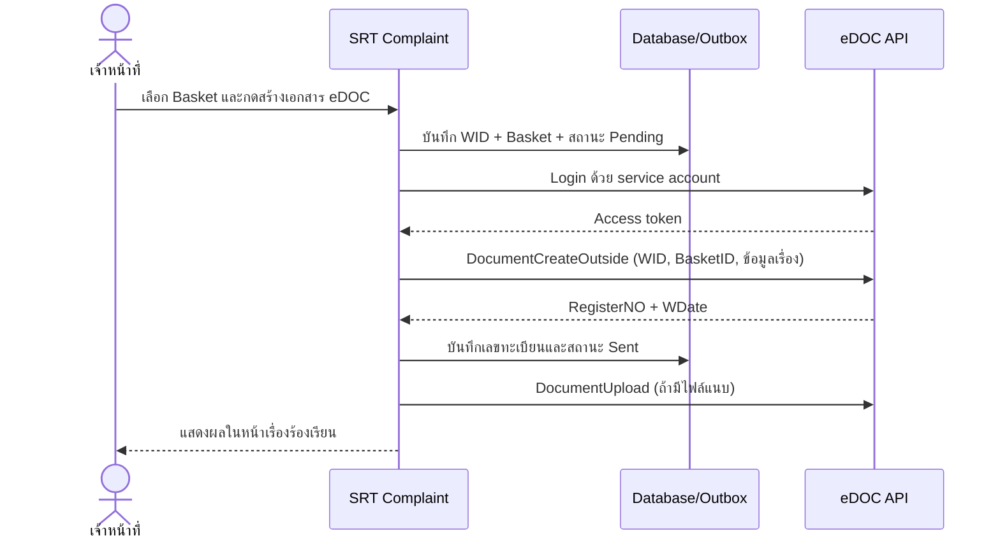

# คู่มือเชื่อมต่อ SRT Complaint → eDOC (RW Saraban API)

เอกสารนี้อธิบายการตั้งค่าและใช้งานปุ่ม **สร้างเอกสาร eDOC** จากหน้ารายละเอียดเรื่องร้องเรียน โดยผู้ใช้ไม่ต้องเข้าสู่ระบบ eDOC ซ้ำ ระบบ SRT Complaint จะใช้บัญชีบริการ (service account) เรียก API เบื้องหลัง และส่ง `BasketID` เพื่อให้เอกสารถูกสร้างในตะกร้าของฝ่าย/สำนักงานที่เลือก

> ห้ามนำชื่อผู้ใช้ รหัสผ่าน หรือ token ที่ได้รับจาก eDOC ลง Git, Postman ที่แชร์สาธารณะ, log หรือภาพหน้าจอ เอกสารตัวอย่างที่ได้รับจากผู้ให้บริการมีข้อมูลลับและควรเปลี่ยนรหัสผ่านก่อนใช้งานจริง

## 1. ภาพรวมการทำงาน



หลักสำคัญ:

- ผู้ใช้ระบบ SRT ไม่ต้องทราบหรือกรอกรหัสผ่าน eDOC
- สิทธิ์กดสร้างเอกสารยังถูกควบคุมโดยระบบ SRT: ผู้รับผิดชอบเรื่องหรือ SuperAdmin เท่านั้น
- หนึ่งเรื่องร้องเรียนสร้างเอกสาร eDOC ได้หนึ่งรายการ โดยใช้เลขอ้างอิงเรื่องเป็น `WID`
- ระบบเก็บ `WID`, `BasketID`, เลขทะเบียน, สถานะ และผลการส่งไฟล์แนบไว้ในฐานข้อมูล
- ถ้าผลการสร้างเอกสารไม่ชัดเจน (เช่น connection หลุดหลังส่งคำขอ) ระบบจะไม่ retry การสร้างโดยอัตโนมัติ เพื่อป้องกันเอกสารซ้ำ

## 2. ข้อมูลที่ต้องขอจากทีม eDOC

ก่อนเปิดใช้งาน ต้องได้รับข้อมูลต่อไปนี้แยกระหว่าง DEV/UAT และ Production:

1. Base URL ของ API ที่ถูกต้อง เช่น DEV ที่ระบุใน Postman คือ `https://edoc.railway.co.th/RwSarabanApiDev/`
2. Username และ Password สำหรับ service account
3. `SarabanUsername` หรือรหัสผู้ใช้งานสารบรรณที่ API ยอมรับ
4. `AppId` (ตัวอย่างเอกสารใช้ค่า 1 ตัวอักษร)
5. `BasketID` ความยาว 13 หลักของทุกฝ่าย/สำนักงานที่อนุญาต
6. ชื่อแสดงผลของแต่ละ Basket
7. ข้อกำหนด `SecretLevel`, `Wstype`, `ReceiveDoc`
8. ขนาดและชนิดไฟล์สูงสุดที่ Production รองรับ
9. Production Base URL และ IP/network allowlist หากมี
10. แนวทางตรวจเอกสารซ้ำจาก `WID` และ SLA/rate limit ของ API

## 3. การตั้งค่า

ค่าโครงสร้างอยู่ใน section `Edoc` ของ `appsettings.json` แต่ข้อมูลลับต้องใส่ผ่าน secret store หรือ environment variables เท่านั้น

ตัวอย่างโครงสร้างที่ไม่มีข้อมูลลับ:

```json
{
  "Edoc": {
    "Enabled": true,
    "Environment": "Development",
    "BaseUrl": "https://edoc.railway.co.th/RwSarabanApiDev/",
    "AllowedHosts": ["edoc.railway.co.th"],
    "AllowPrivateNetwork": false,
    "Username": "",
    "Password": "",
    "AppId": "1",
    "SarabanUsername": "",
    "BasketId": "",
    "Baskets": [
      { "Id": "1234567890123", "Name": "ฝ่ายตัวอย่าง A" },
      { "Id": "9876543210987", "Name": "สำนักงานตัวอย่าง B" }
    ],
    "CategoryBasketMappings": {
      "1": "1234567890123",
      "2": "9876543210987"
    },
    "FromName": "งานประชาสัมพันธ์และรับเรื่องราวร้องเรียน",
    "DefaultSendTo": "",
    "SecretLevel": "0",
    "Wstype": "",
    "ReceiveDoc": "",
    "UseBuddhistYear": true,
    "DocumentDateSeparator": "/",
    "MaxAttachmentBytes": 10485760,
    "MaxResponseBytes": 1048576,
    "TrackingIntervalMinutes": 30
  }
}
```

### 3.1 ความหมายของ Basket

- `Baskets` คือ allowlist ที่จะแสดงใน dropdown บนหน้าเรื่องร้องเรียน ผู้ใช้ส่งค่าอื่นนอกรายการไม่ได้
- `BasketId` รองรับกรณีมี Basket เดียวแบบเดิม ถ้ากำหนดทั้งสองแบบ ระบบจะรวม `BasketId` เข้าในรายการ
- `CategoryBasketMappings` ใช้ **Category ID ของระบบ SRT** เป็น key และใช้ Basket ID เป็น value เพื่อเลือกค่าเริ่มต้นให้อัตโนมัติ
- ผู้ใช้ยังเปลี่ยน Basket ก่อนกดสร้างได้ ถ้ามีหลายรายการ
- Basket ที่ถูกเลือกจะถูกบันทึกพร้อมเอกสาร เปลี่ยนย้อนหลังไม่ได้หลังเริ่มส่ง

### 3.2 Environment variables

ตัวอย่างชื่อตัวแปรสำหรับ Production:

```text
Edoc__Enabled=true
Edoc__Environment=Production
Edoc__BaseUrl=https://<production-host>/<production-base-path>/
Edoc__AllowedHosts__0=<production-host>
Edoc__Username=<secret-service-username>
Edoc__Password=<secret-service-password>
Edoc__AppId=1
Edoc__SarabanUsername=<saraban-api-user>
Edoc__Baskets__0__Id=1234567890123
Edoc__Baskets__0__Name=ฝ่ายตัวอย่าง A
Edoc__Baskets__1__Id=9876543210987
Edoc__Baskets__1__Name=สำนักงานตัวอย่าง B
Edoc__CategoryBasketMappings__1=1234567890123
Edoc__CategoryBasketMappings__2=9876543210987
```

บน Windows/IIS ใช้ environment variables ของ App Pool หรือ secret provider ขององค์กร ส่วน Docker/Kubernetes ควรอ้างจาก Secret และไม่เขียนค่าลับลง image หรือ manifest ที่ commit เข้า Git

### 3.3 ข้อกำหนด validation ตอนเริ่มระบบ

เมื่อ `Enabled=true` ระบบจะไม่ยอมเริ่มถ้า:

- Base URL ไม่ใช่ HTTPS หรือ hostname ไม่อยู่ใน `AllowedHosts`
- ตั้ง `Environment=Production` แต่ path ยังมีคำว่า `ApiDev`
- ขาด Username, Password หรือ SarabanUsername
- ไม่มี Basket อย่างน้อยหนึ่งรายการ หรือ Basket ID ไม่ใช่ตัวเลข 13 หลัก
- category mapping ชี้ไป Basket ที่ไม่ได้อยู่ใน allowlist
- ค่าขนาดไฟล์/response หรือ tracking interval อยู่นอกช่วงที่รองรับ

## 4. การ map ข้อมูล

| ฟิลด์ eDOC | แหล่งข้อมูล SRT Complaint | หมายเหตุ |
|---|---|---|
| `rqHeader.appId` | `Edoc:AppId` | ค่าที่ eDOC ออกให้ |
| `WID` | `Complaint.ReferenceNumber` | unique และใช้ตรวจเอกสารซ้ำ |
| `Username` | `Edoc:SarabanUsername` | ผู้ใช้งานสารบรรณของ service account |
| `BasketID` | Basket ที่ผู้ใช้เลือก | ต้องอยู่ใน allowlist |
| `RefNumber` | `ExternalId` หรือ `ReferenceNumber` | จำกัด 100 ตัวอักษร |
| `From` | `Edoc:FromName` | ชื่อหน่วยงานต้นทาง |
| `SendTo` | `Category.DepartmentName` หรือ `DefaultSendTo` | ต้องมีอย่างน้อยหนึ่งค่า |
| `Subject` | เลขเรื่อง + ชื่อหมวด | จำกัด 255 ตัวอักษร |
| `DocDate` | `Complaint.CreatedAt` เวลาไทย | พ.ศ./ค.ศ. กำหนดได้ |
| `Priority` | Critical/Urgent/High/อื่น ๆ | map เป็น `03/02/01/00` |
| `SecretLevel` | configuration | ค่าเริ่มต้น `0` |
| `Description` | รายละเอียดเรื่องร้องเรียน | จำกัด 2,000 ตัวอักษร |
| `Remark` | เลขอ้างอิงเรื่อง | จำกัด 300 ตัวอักษร |
| `Wstype`, `ReceiveDoc` | configuration | ใช้ตามข้อกำหนด eDOC |

ไฟล์แนบถูกส่งหลังสร้างเอกสารสำเร็จ โดยใช้ `DocumentUpload`, `LinkWID` เท่ากับ WID ของเรื่อง และ Base64 เฉพาะไฟล์ที่อยู่ใน approved storage ของระบบ ขนาดต่อไฟล์ควบคุมด้วย `MaxAttachmentBytes` (ค่าเริ่มต้น 10 MB)

## 5. การใช้งานหน้า Case Detail

1. เปิดเรื่องร้องเรียนที่ตนรับผิดชอบ
2. ในการ์ด **เอกสาร eDOC** เลือกฝ่าย/สำนักงาน (Basket)
3. กด **สร้างเอกสาร eDOC** และยืนยัน
4. รอผลที่หน้าเดิม ระบบจะแสดง WID และเลขทะเบียนเมื่อ eDOC ตอบสำเร็จ
5. ใช้ **ตรวจสอบสถานะ eDOC** เพื่อดึงสถานะล่าสุด หรือปล่อยให้ background worker ตรวจทุกช่วงเวลาที่กำหนด

สถานะภายใน:

| สถานะ | ความหมาย/การดำเนินการ |
|---|---|
| `Pending` | รอ worker ส่ง หรือกำลังเริ่มส่งทันที |
| `Sending` | ล็อกงานเพื่อป้องกัน worker ส่งซ้ำ |
| `Sent` | eDOC ยืนยันการสร้างเอกสารแล้ว |
| `SentWithAttachmentErrors` | เอกสารถูกสร้างแล้ว แต่ไฟล์แนบบางรายการต้องตรวจสอบ |
| `NeedsReview` | ผลการสร้างไม่ชัดเจน ต้องกดตรวจสอบว่ามีเอกสารแล้วหรือยังก่อน retry |
| `Failed` | eDOC ปฏิเสธอย่างชัดเจน ผู้ดูแลแก้ข้อมูลแล้วส่งใหม่ได้ |

การ retry เอกสารและไฟล์แนบสงวนให้ SuperAdmin เพราะ API ที่ได้รับไม่ได้ระบุ idempotency key สำหรับ create/upload

## 6. ติดตั้งฐานข้อมูลและเปิดใช้งาน

1. สำรองฐานข้อมูล
2. deploy application version ใหม่โดยยังตั้ง `Edoc:Enabled=false`
3. ใช้ migration `AddEdocOutboundIntegration`
4. ตั้ง secret และ Basket ของ DEV/UAT
5. เปิด `Edoc:Enabled=true` ใน DEV/UAT แล้ว restart application
6. ทดสอบด้วยเรื่องทดสอบและ Basket ทดสอบ
7. ตรวจทั้งหน้า SRT และหน้าระบบ eDOC ว่าเอกสารอยู่ใน Basket ถูกต้อง
8. ขอ Production URL/credentials ชุดใหม่ แยกจาก DEV และหมุนรหัสผ่านที่ปรากฏในเอกสารตัวอย่าง
9. เปิด Production หลังทีม eDOC ยืนยันผล UAT

สร้าง SQL แบบ idempotent ให้ DBA ตรวจและนำไปใช้กับฐานข้อมูลเป้าหมาย (อย่าใส่ connection string ที่มีรหัสผ่านลง command history):

```powershell
dotnet ef migrations has-pending-model-changes --project SRT.Complaint/SRT.Complaint.csproj --startup-project SRT.Complaint/SRT.Complaint.csproj --context AppDbContext
dotnet ef migrations script --idempotent --project SRT.Complaint/SRT.Complaint.csproj --startup-project SRT.Complaint/SRT.Complaint.csproj --context AppDbContext --output db/production-migrations.sql
```

สำหรับการเปลี่ยนแปลง eDOC รอบนี้ มี SQL ที่สร้างจาก migration แล้วใน `db/edoc-outbound-integration.sql` (จาก migration ก่อนหน้าไป `AddEdocOutboundIntegration`) ให้ DBA ตรวจอีกครั้งก่อนรัน

## 7. UAT checklist

- สร้างเอกสารโดยเลือก Basket A แล้วเอกสารขึ้นที่ฝ่าย A จริง
- สร้างอีกเรื่องโดยเลือก Basket B แล้วเอกสารขึ้นที่สำนักงาน B จริง
- category mapping เลือก Basket เริ่มต้นถูกต้อง
- ผู้ใช้ที่ไม่ได้รับผิดชอบเรื่องกดสร้างไม่ได้
- ผู้ใช้ไม่ถูกถาม username/password ของ eDOC
- เลขทะเบียน (`RegisterNO`) และ WID แสดงและบันทึกถูกต้อง
- ภาษาไทย วันที่ และระดับความเร่งด่วนแสดงถูกต้องใน eDOC
- PDF/JPG/DOCX ที่รองรับถูก upload และเปิดอ่านได้
- network timeout ไม่สร้างรายการซ้ำเมื่อผู้ใช้ refresh
- ปุ่มตรวจสอบพบเอกสารเดิมในกรณี response ของ create ขาดหาย
- token หมดอายุแล้วระบบ login ใหม่อัตโนมัติ
- log ไม่มี password, access token, Base64 ของไฟล์ หรือรายละเอียดส่วนบุคคลเต็มชุด

## 8. ข้อจำกัด/ข้อมูลที่ต้องยืนยันกับ eDOC

- เอกสารที่ได้รับให้เฉพาะ DEV URL; Production URL ต้องขอและยืนยันก่อนเปิดจริง
- Inquiry ถูกนิยามเป็น HTTP GET ที่มี JSON body ซึ่ง proxy บางชนิดอาจตัด body ต้องทดสอบผ่าน network จริง
- เอกสารไม่ระบุ idempotency key สำหรับ create และ upload จึงใช้ WID + local durable state + manual reconciliation แทน
- ยังไม่มีรูปแบบ deep link ไปหน้าเอกสาร eDOC ที่ยืนยันจากผู้ให้บริการ จึงแสดง WID/เลขทะเบียนแทน
- ต้องยืนยันค่า required ที่ตัวอย่างส่งเป็นค่าว่าง (`Wstype`, `ReceiveDoc`) และขนาดไฟล์สูงสุดกับทีม eDOC
- หากทีม eDOC รองรับ OAuth client credentials, mTLS หรือ certificate-based authentication ควรพิจารณาแทนรหัสผ่านระยะยาว

## 9. ข้อมูลสำหรับแจ้งทีม eDOC เมื่อขอความช่วยเหลือ

ส่งเฉพาะข้อมูลที่จำเป็น:

- environment (DEV/UAT/Production)
- เวลาเกิดเหตุพร้อม timezone
- WID และ BasketID
- HTTP status และ remote error code ที่ระบบแสดง
- correlation/request ID ถ้า eDOC มีให้

ห้ามส่ง password, access token, authorization header, Base64 file หรือข้อมูลผู้ร้องเรียนเกินความจำเป็น

